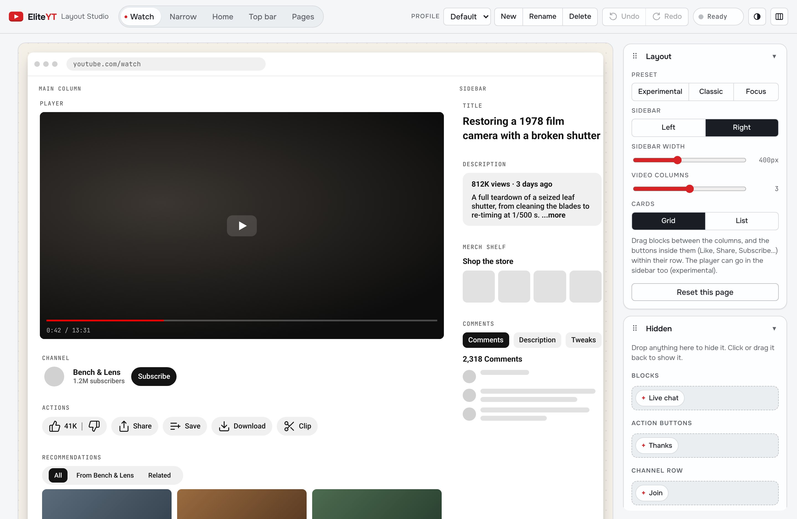
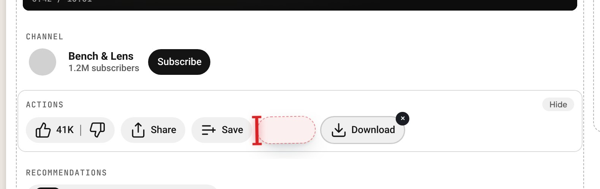
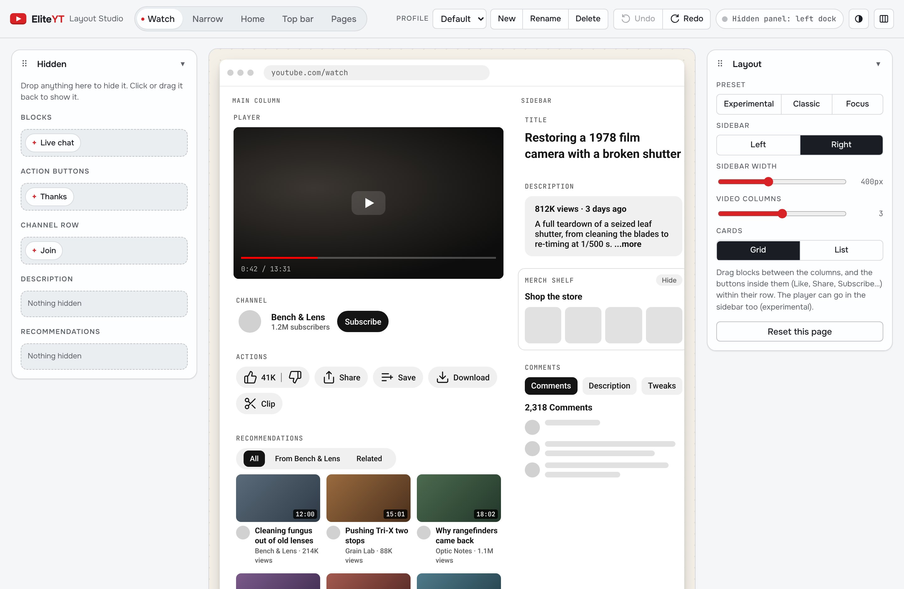
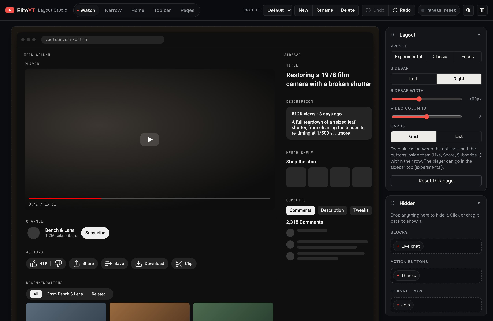
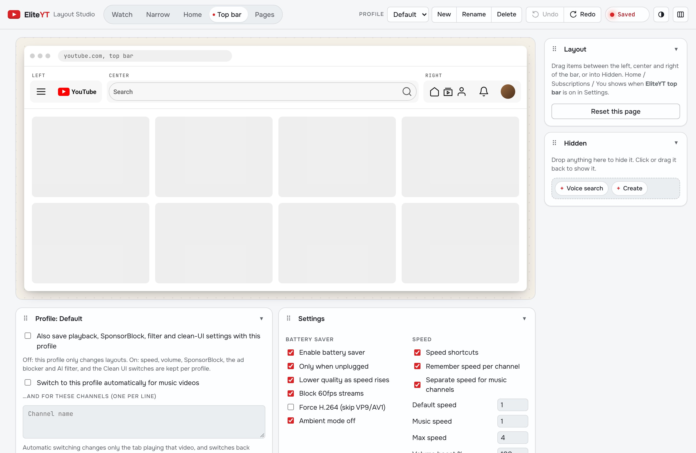
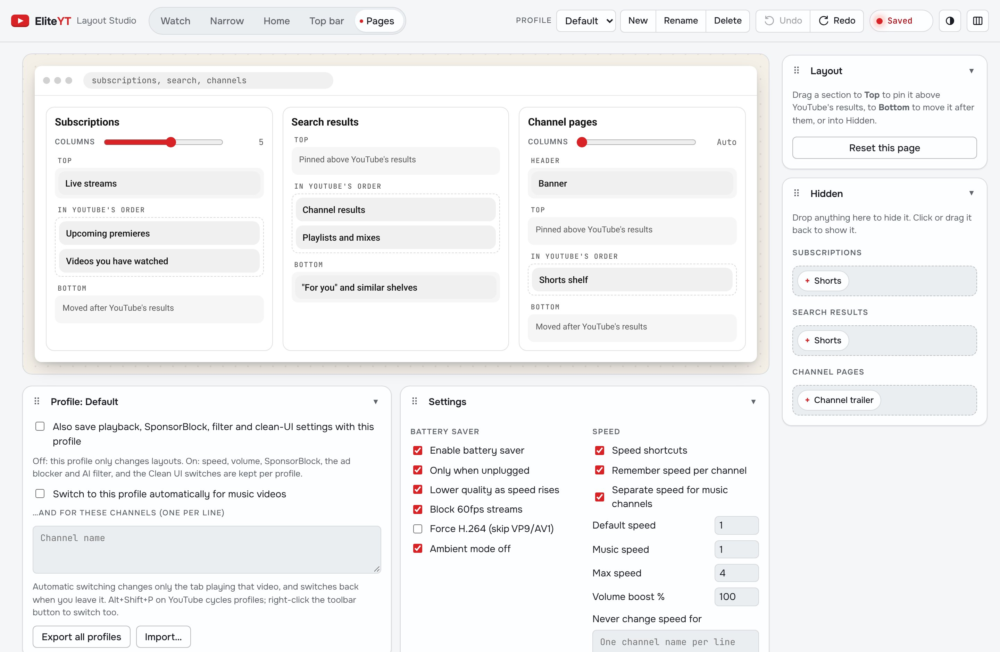
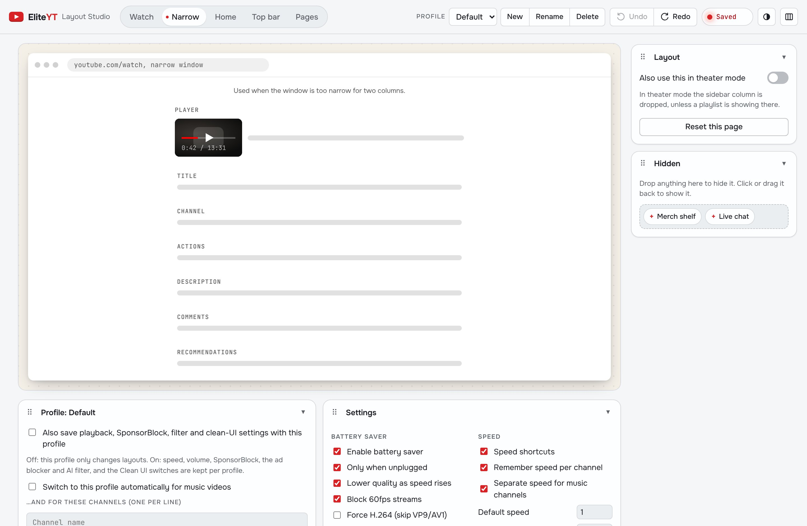

# EliteYT

> A Chrome / Helium / Firefox extension that rearranges YouTube around the video: calmer home, comments beside the player, pause screen, its own ad blocker, an AI / low-effort video filter, SponsorBlock, DeArrow and Return YouTube Dislike built in.

**Site & teaser:** https://dronzer-studios.github.io/eliteyt/

## What it does

- **Watch page:** the sidebar becomes a Comments / Description / Tweaks panel that scrolls on its own; channel, filter chips and likes share one row under the video; recommendations become a grid.
- **On the player:** the title shows with the controls on hover; pausing blurs the frame and shows the title, channel, views, date and description.
- **Home:** carousel (last video, then new uploads from recently watched channels), Continue watching, From your subscriptions, a "New" badge, calm thumbnails (real video frames instead of creator artwork). No left sidebar; Home / Subscriptions / You sit by the avatar.
- **Ad blocker:** EliteYT's own, YouTube only. It strips ads from YouTube's data before the player sees them (video ads, feed, sidebar and search ads, promo banners), hides any ad slot that still renders, and if an ad plays anyway, mutes it, runs it at 16× and presses Skip.
- **AI & low-effort filter:** flags videos the creator disclosed as altered or synthetic, videos that label themselves AI-made ("AI generated", #aivideo, "made with Sora"), and low-effort formats (TTS reddit stories, clickbait templates, hashtag and emoji spam). Flagged cards are blurred with the reason and a **Show** button (or hidden), and a flagged video gets a cover with **Watch anyway** / **Always allow channel**. It's heuristic and runs entirely in the browser: reviews and news *about* AI aren't flagged, a strict mode catches more, and channels can be allow- or block-listed.
- **Built in:** SponsorBlock (skips + progress-bar markers), DeArrow (community titles and thumbnails), Return YouTube Dislike.
- **Speed:** `[` `]` `\` keys, speed remembered per channel, separate speed for music, a never-change list.
- **Battery saver (unplugged):** ≥2.5× plays at 480p, ≥1.75× at 720p, 60 fps streams skipped, ambient mode off.

## Quick Start

```sh
git clone https://github.com/Dronzer-Studios/eliteyt
```

**Chrome / Helium:** open `chrome://extensions`, turn on **Developer mode**, click **Load unpacked** and pick the `eliteyt` folder.

**Firefox (140+, Android 142+):**

1. Open `about:debugging#/runtime/this-firefox`.
2. Click **Load Temporary Add-on** and pick `eliteyt/manifest.json`.
3. Open any YouTube video: the sidebar should turn into the Comments / Description / Tweaks panel, and the EliteYT icon appears in the toolbar (pin it from the puzzle-piece menu).

Temporary add-ons are removed when Firefox restarts; repeat step 2, or click **Reload** on the same page after pulling changes. Battery saver is Chrome-only (Firefox has no Battery API); everything else works the same.

To check or package the Firefox build (`web-ext-config.mjs` keeps `docs/` out of the zip):

```sh
npx web-ext lint                 # should report 0 errors, 0 warnings
npx web-ext run                  # launches a clean Firefox with EliteYT loaded
npx web-ext build                # zip in web-ext-artifacts/, ready for AMO
```

## Tests

The extension has no build step; `package.json` only holds dev tooling.

```sh
npm install
npx playwright install chromium
npm test                     # every suite; or: node tests/run.js adblock slop
npm run lint                 # web-ext lint
```

Each suite in `tests/` loads the unpacked extension in Chromium and serves YouTube-shaped fixture pages through request interception, so no test touches youtube.com. CI (`.github/workflows/ci.yml`) runs them, plus `web-ext lint`, on every pull request.

## Usage

Click the EliteYT button in the toolbar (or in the browser's extensions menu) to open the **Layout Studio**. Right-click the button to switch layout profile.



**Everything moves.** Five views, each a mock page you drag things around on:
- **Watch:** the blocks (player, title, channel, actions, description, comments, recommendations, merch, chat) between the main column and the sidebar, the player included, and the parts inside them: Like, Share, Save, Download, Clip, Thanks; avatar, name, Join, Subscribe; views and date, description text; filter chips.
- **Narrow:** the one-column order for narrow windows (and theater mode, if you want).
- **Home:** the carousel and shelves.
- **Top bar:** YouTube's top bar items between left, center and right.
- **Pages:** subscriptions, search and channel sections pinned to the top, left in YouTube's order, moved to the bottom, plus column counts.

Drop anything in the **Hidden** panel to hide it; click it to bring it back. With the keyboard: Alt+arrows move the focused item, Alt+Shift+arrows move it to the next column or zone, Delete hides, Enter restores. **Undo / Redo** (Ctrl+Z / Ctrl+Shift+Z) steps back through every edit.

The studio's own panels (Layout, Hidden, Profile, Settings) move too: drag a panel by its grip into the left, right or bottom dock, fold it, or use the arrow keys on the grip. Every setting is in the **Settings** panel.

| Splice line while dragging | Panels rearranged | Dark |
|---|---|---|
|  |  |  |

| Top bar | Pages | Narrow | Home |
|---|---|---|---|
|  |  |  |  |

**Profiles** keep several sets of layouts side by side. **New** saves the current layouts under a name; edits go into the selected profile. In the **Profile** panel a profile can also:
- carry its own playback, SponsorBlock, filter and Clean UI settings (otherwise all profiles share them);
- switch on automatically for music videos or chosen channels; this changes only the tab playing that video and switches back when you leave it;
- be exported to a JSON file and imported again (or shared).

Switch profiles in the studio, from the toolbar button's right-click menu, in the **Tweaks** tab beside a video, or with **Alt+Shift+P** on YouTube.

## Architecture

| File | World | Role |
|---|---|---|
| `src/background.js` | background | toolbar button opens the Layout Studio; right-click menu switches profile |
| `src/bridge.js` | isolated | `chrome.storage` ↔ page (localStorage mirror + `eliteyt:settings` event), profiles per tab |
| `src/profiles.js` | shared | layout profiles: storage, switching, automatic rules |
| `src/main.js` | main | player API: speed, quality, volume, layout, comments panel, pause screen |
| `src/sponsor.js` | main | SponsorBlock, DeArrow, Return YouTube Dislike, calm thumbnails |
| `src/home.js` | main | home shelves, carousel, top bar |
| `src/pieces.js` | main | parts inside watch-page blocks and top-bar items: order and hide |
| `options.html`, `options.js`, `studio/` | page | the Layout Studio |
| `src/adblock.js` | main | ad blocker: prunes ads from player/feed JSON, skips ads that still play |
| `src/slop.js` | main | AI-generated / low-effort video filter (feed cards + watch page) |
| `docs/` | — | GitHub Pages site and teaser video |

SponsorBlock and DeArrow are queried by a 4-character SHA-256 prefix of the video ID; Return YouTube Dislike needs the full ID.

## License

[GPL-3.0](LICENSE) © 2026 Dronzer Studios. You may use, study, share and modify EliteYT; derivative works must stay under GPL-3.0 with source available.

Brought to you by [Dronzer Studios](https://github.com/Dronzer-Studios), creators of Thallium 81 & hardware infrastructure. Not affiliated with YouTube or Google.
