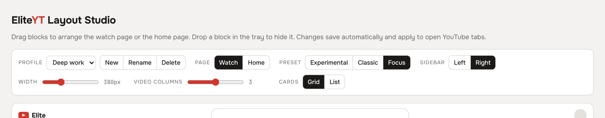
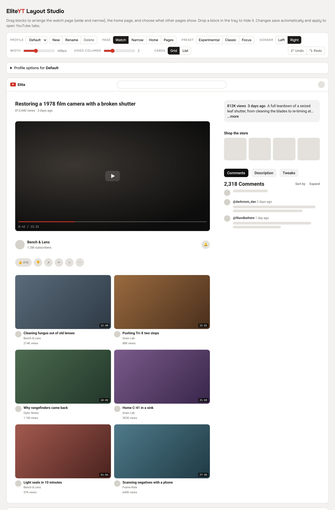
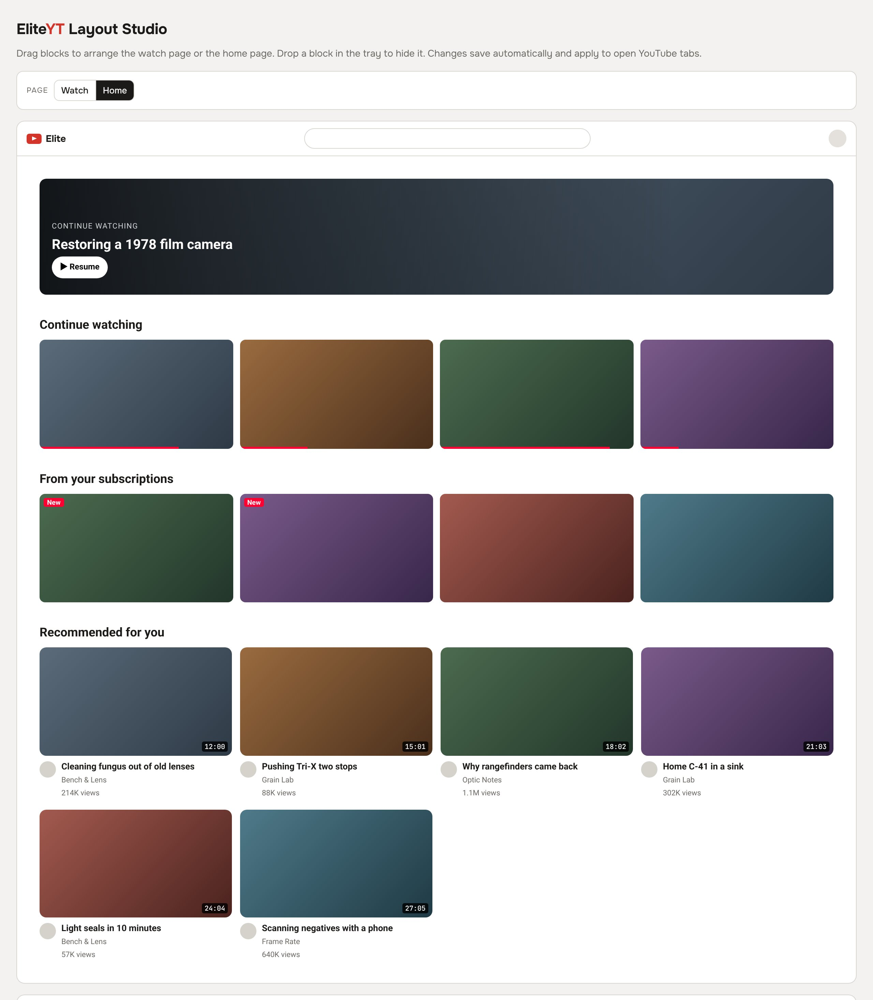
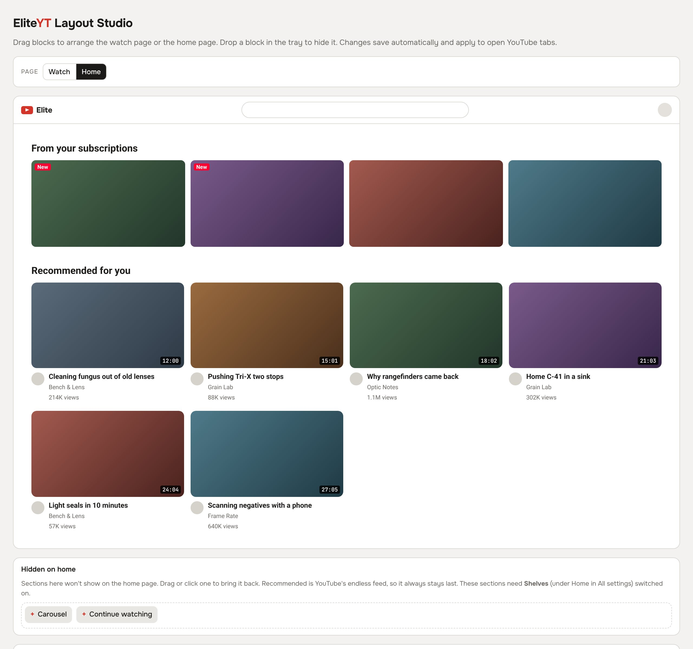

# EliteYT

> A Chrome / Helium / Firefox extension that rearranges YouTube around the video: calmer home, comments beside the player, pause screen, SponsorBlock, DeArrow and Return YouTube Dislike built in.

**Site & teaser:** https://dronzer-studios.github.io/eliteyt/

## What it does

- **Watch page:** the sidebar becomes a Comments / Description / Tweaks panel that scrolls on its own; channel, filter chips and likes share one row under the video; recommendations become a grid.
- **On the player:** the title shows with the controls on hover; pausing blurs the frame and shows the title, channel, views, date and description.
- **Home:** carousel (last video, then new uploads from recently watched channels), Continue watching, From your subscriptions, a "New" badge, calm thumbnails (real video frames instead of creator artwork). No left sidebar; Home / Subscriptions / You sit by the avatar.
- **Built in:** SponsorBlock (skips + progress-bar markers), DeArrow (community titles and thumbnails), Return YouTube Dislike.
- **Speed:** `[` `]` `\` keys, speed remembered per channel, separate speed for music, a never-change list.
- **Battery saver (unplugged):** ≥2.5× plays at 480p, ≥1.75× at 720p, 60 fps streams skipped, ambient mode off.

## Quick Start

```sh
git clone https://github.com/Dronzer-Studios/eliteyt
```

**Chrome / Helium:** open `chrome://extensions`, turn on **Developer mode**, click **Load unpacked** and pick the `eliteyt` folder.

**Firefox (140+, Android 142+):**

1. Open `about:debugging#/runtime/this-firefox`.
2. Click **Load Temporary Add-on** and pick `eliteyt/manifest.json`.
3. Open any YouTube video: the sidebar should turn into the Comments / Description / Tweaks panel, and the EliteYT icon appears in the toolbar (pin it from the puzzle-piece menu).

Temporary add-ons are removed when Firefox restarts; repeat step 2, or click **Reload** on the same page after pulling changes. Battery saver is Chrome-only (Firefox has no Battery API); everything else works the same.

To check or package the Firefox build (`web-ext-config.mjs` keeps `docs/` out of the zip):

```sh
npx web-ext lint                 # should report 0 errors, 0 warnings
npx web-ext run                  # launches a clean Firefox with EliteYT loaded
npx web-ext build                # zip in web-ext-artifacts/, ready for AMO
```

## Usage

Settings live in the toolbar popup; **Open full settings** has the drag-and-drop layout editor and presets. Switch its **Page** control to **Home** to reorder or hide the home sections (carousel, Continue watching, From your subscriptions, Recommended). Every feature can be switched off there.

**Profiles** keep several layouts (watch + home) side by side: **New** saves the current layout under a name, edits go into the selected profile, and the toolbar popup can switch between them from any tab. Speed, volume and the other settings are shared by all profiles.



| Watch page: title above the player | Home page: all sections | Home page: carousel and Continue watching hidden |
|---|---|---|
|  |  |  |

## Architecture

| File | World | Role |
|---|---|---|
| `src/bridge.js` | isolated | `chrome.storage` ↔ page (localStorage mirror + `eliteyt:settings` event) |
| `src/main.js` | main | player API: speed, quality, volume, layout, comments panel, pause screen |
| `src/sponsor.js` | main | SponsorBlock, DeArrow, Return YouTube Dislike, calm thumbnails |
| `src/home.js` | main | home shelves, carousel, top bar |
| `docs/` | — | GitHub Pages site and teaser video |

SponsorBlock and DeArrow are queried by a 4-character SHA-256 prefix of the video ID; Return YouTube Dislike needs the full ID.

## License

[GPL-3.0](LICENSE) © 2026 Dronzer Studios. You may use, study, share and modify EliteYT; derivative works must stay under GPL-3.0 with source available.

Brought to you by [Dronzer Studios](https://github.com/Dronzer-Studios), creators of Thallium 81 & hardware infrastructure. Not affiliated with YouTube or Google.
